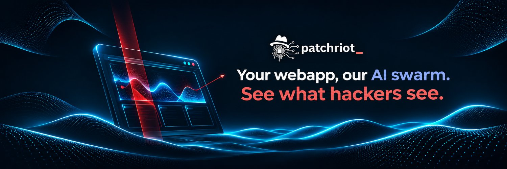
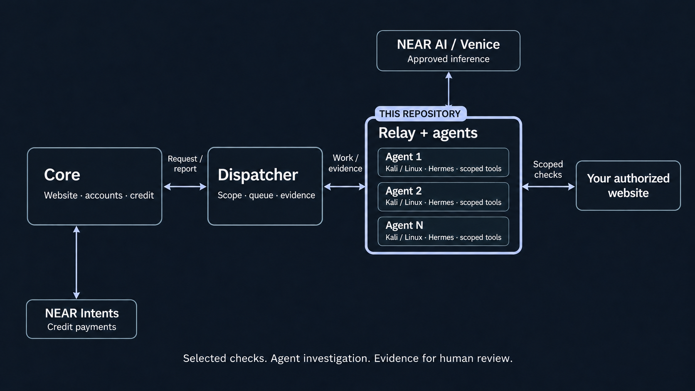

<p align="center"></p>

# Patchriot relay

**Connect an agent machine. Keep its work within the agreed scope.** The relay pairs your machine with a Patchriot dispatcher, runs Hermes in a restricted container and returns evidence for a private security report. The local HTTP-only trial also works on macOS with Docker Desktop.

Patchriot is a **pre-penetration testing suite**: selected tools and agent-led investigation help a human team find and assess weaknesses. A completed agent run is not proof that a website is safe.

[Hosted service](https://patchriot.net) · [Full local setup](https://github.com/adaki2004/patchriot-core#run-locally) · [Checks and tools](https://patchriot.net/#/docs/checks)

## Architecture



| Repository | Responsibility |
| --- | --- |
| [patchriot-core](https://github.com/adaki2004/patchriot-core) | Website, accounts, payments and shared protocol |
| [patchriot-dispatcher](https://github.com/adaki2004/patchriot-dispatcher) | Permission, scheduling, leases and reports |
| **[patchriot-relay](https://github.com/adaki2004/patchriot-relay)** · you are here | Device pairing, container execution, scoped HTTP and inference access |

The **Rust relay is trusted host software**. It holds the device key, checks target permissions and owns the provider connection. The agent container receives no provider key, host home directory or Docker socket. Its network is disabled; permitted model and target calls pass through the relay. Docker access makes the relay operator a trusted host administrator.

Scout investigates; a different device runs Recon to validate findings and explore a few missed leads. These are sequential roles, not votes. Devices sharing a host or operator do not establish independent trust. Joining the hosted worker pool requires staff approval; pairing alone does not grant private work.

## Two NEAR building blocks

- **[NEAR AI](https://docs.near.ai/cloud/verification):** the relay's NEAR route encrypts model exchanges and checks attestation and response signatures before returning model output. Verification covers inference, not the operator's machine or a finding's accuracy.
- **[NEAR Intents / 1Click](https://docs.near-intents.org/integration/distribution-channels/1click-api/about-1click-api):** core settles customer top-ups. The relay receives approved work, never treasury keys or authority to move customer funds.

NEAR AI and Venice may be primary or backup. Backup use requires saved requester consent and is recorded in the result. Invalid attestation, bad credentials and exhausted budgets do not trigger silent recovery. The separate Venice route does not claim NEAR attestation verified by Patchriot.

## Tool inventory and provenance

| Tool | What Patchriot uses |
| --- | --- |
| [Hermes Agent](https://github.com/NousResearch/hermes-agent) | Investigation, follow-up hypotheses and report validation |
| [Nuclei](https://github.com/projectdiscovery/nuclei) | Repository-reviewed HTTP templates, without updates or external callbacks |
| [ARES-derived fingerprints](https://github.com/Mafifrizi/ARES) | Adapted HTTP signatures only; the full framework is not run |
| [ffuf](https://github.com/ffuf/ffuf) | Small candidate-path samples with missing-page controls |
| [ZAP](https://www.zaproxy.org/) | Selected passive checks and an authorized reflected-input rule |
| [Schemathesis](https://github.com/schemathesis/schemathesis) | Bounded read cases from supported observed API schemas |
| [Chromium](https://www.chromium.org/), [Playwright](https://github.com/microsoft/playwright), [agent-browser](https://github.com/vercel-labs/agent-browser) | Restricted browser exploration, login and access comparisons |
| Patchriot adapters | Headers, route discovery, optional deeper probes, account comparisons and evidence accounting |

Every report identifies the tools actually used. A missing schema or absent second account cannot count as successful testing. Selected checks can finish with a sample limit; interrupted checks remain incomplete. All target I/O stays behind the same origin, DNS, method, time and byte limits.

The [Dockerfile](agent/Dockerfile) pins the Hermes base, Debian snapshot and downloaded dependencies. `/patchriot/toolchain.json` inside the image records versions and hashes. Pins make inputs reviewable; they do not prove identical rebuilds or vulnerability-free dependencies. Upstream licenses and revisions are in [NOTICE](NOTICE).

<a id="what-the-safety-limits-mean"></a>

## Run an agent

Start core and dispatcher using the [local setup](https://github.com/adaki2004/patchriot-core#run-locally). Keep all three repositories as siblings. Install Git, Rust 1.94.1 and Docker Desktop (macOS) or Docker Engine with cgroup v2 (Linux). The image includes Hermes and its tools; no local GPU, model download or separate Kali/VM installation is needed for the HTTP-only trial. Allow at least 4 GiB of container memory per active agent. Use your own supported provider key.

```sh
cargo build --locked
docker build -t patchriot-agent:local agent
docker image inspect --format '{{.Id}}' patchriot-agent:local
docker context inspect --format '{{.Endpoints.docker.Host}}'
```

### 1. Configure inference

The relay uses CLI arguments and JSON; **it does not read `.env`**. The [example settings](agent-settings.example.json) use **NEAR AI first, Venice as backup**, with a 900-second ceiling per role. The [complete local walkthrough](https://github.com/adaki2004/patchriot-core#4-configure-near-ai-and-its-backup) creates these files and pairs both devices.

Copy the settings outside the checkout. Use the exact image `sha256:` ID above, your Docker socket and absolute paths to your private `near-ai.key` and `venice.key` files. Each key file contains only its provider API key. Make all three files owner-only (`chmod 600`); keys never go into JSON, Git, core or dispatcher. Get a funded key from [NEAR AI](https://docs.near.ai/cloud/quickstart) and [Venice](https://docs.venice.ai/api-reference/api-spec).

Set dispatcher’s `PATCHRIOT_INFERENCE_PRIMARY_MODEL` and `PATCHRIOT_INFERENCE_SECONDARY_MODEL` to the matching models below. For NEAR alone, remove both secondary fields from the JSON and leave dispatcher’s secondary setting unset. The backup is available only with requester consent and on eligible recovery errors.

| Setting | Required value / purpose |
| --- | --- |
| `docker_socket` | Use the local path printed above, removing `unix://`. Docker Desktop may use a socket inside your home directory rather than `/var/run/docker.sock`. Remote Docker endpoints are not supported here. |
| `image` | Inspected immutable image ID, not a mutable tag |
| `model_url`, `model` | One matching supported pair below; also used when pairing |
| `model_digest` | `provider-managed-not-attested` for API-managed weights; NEAR verifies its separate runtime evidence |
| `live_provider_key_file` | Absolute path to a mode-0600 key file owned by the relay user |
| `max_attempt_seconds` | Per-role ceiling, default 600, maximum 10800; dispatcher allowance can be lower |
| `secondary_model`, `secondary_key_file` | Optional: both set or both omitted; select the other supported provider |

| Provider | Model | API |
| --- | --- | --- |
| NEAR AI | `deepseek-ai/DeepSeek-V4.1-Flash-1017-abliterated` | `https://cloud-api.near.ai/v1` |
| Venice | `deepseek-v4-1-flash-1017-uncensored` | `https://api.venice.ai/api/v1` |

The table lists the models supported by this relay version. Check provider availability and credit before accepting work; changing to an arbitrary model name is not supported. The local example does not set the hosted service’s route order.

### 2. Pair and approve

Example for a local dispatcher and a NEAR-configured device. Match `--model` to your settings and `--audience` to dispatcher configuration:

```sh
target/debug/patchriot-relay init \
  --state-dir ../local-agent-one \
  --dispatcher http://127.0.0.1:7411 \
  --audience patchriot-local-v1 \
  --label "Local agent one" --compute-group "my-machine" \
  --runtime hermes --runtime-version 0.22.5 \
  --model deepseek-ai/DeepSeek-V4.1-Flash-1017-abliterated
target/debug/patchriot-relay pair --state-dir ../local-agent-one
```

In the local website, open **Agent approvals → Pair a relay**, claim the displayed code, then approve the device. Choose **Allow private reviews**, enable **Live website tests**, and approve only these capabilities for the HTTP trial:

| Checkbox | Capability |
| --- | --- |
| Web and API checks | `scoped_discovery_v1` |
| Signed-in HTTP requests | `authenticated_http_v1` |
| Session login | `session_login_v1` |
| Extra context and site gates | `run_context_v1` |

Leave browser and other untested capabilities unapproved. Repeat with a second state directory and label for the two-agent review. Use the **same compute group** on the same machine to prevent oversubscription. Keep the same OS user for pairing and service execution.

<a id="private-tailscale-connection"></a>

For remote machines, use the **agent-only gateway** over HTTPS or your private mesh. Never expose the internal dispatcher listener. `mesh-check --dispatcher https://HOST` checks a configured Tailscale route; it does not create the mesh.

### 3. Check the sandbox and connect

For the **HTTP-only local trial**, run `doctor`, connect both agents and use the `scripts/local-audit.py` walkthrough in core:

```sh
target/debug/patchriot-relay doctor \
  --state-dir ../local-agent-one --agent-config /absolute/private/agent.json
target/debug/patchriot-relay connect \
  --state-dir ../local-agent-one --agents \
  --agent-config /absolute/private/agent.json --live-tests
```

Start the second device in another terminal. Confirm both are online and eligible before creating a test. `doctor` inspects the installed image; its listed tools are not proof that every sandbox feature works on your host. Only approve the four HTTP capabilities above for this trial. Do not combine live mode with the older snapshot/source opt-ins.

**macOS:** use Docker Desktop for the documented HTTP-only trial. It runs real Hermes inference and records HTTP evidence without requiring a separate VM. Docker Desktop on our tested Mac does not provide the AppArmor profile required by the full browser path, so do not approve browser capabilities there. Full browser tests remain available on the hosted service and compatible Linux agent hosts. Do not add `--no-sandbox`, privileged mode or host networking to make a failed browser check pass.

<details>
<summary>Linux hosts: enabling the full browser sandbox</summary>

Full browser scopes need Chromium's nested namespace sandbox and the supplied [AppArmor profile](agent/browser-apparmor). On a compatible AppArmor-enabled Linux host, inspect the profile before loading it:

```sh
sudo apparmor_parser -r agent/browser-apparmor
```

Test the browser path before approving its capabilities. This step is not part of the macOS local trial.

</details>

<a id="keep-a-relay-running"></a>

## Operating safely

| Command | Purpose |
| --- | --- |
| `status --state-dir PATH` | Check pairing and local pause state |
| `doctor --state-dir PATH --agent-config FILE` | Inspect configuration, image and readiness |
| `pause --state-dir PATH` / `resume --state-dir PATH` | Stop accepting work / resume contribution |
| `skills --state-dir PATH --agent-config FILE` | Inspect capabilities available from the installed image |
| `update-agent --state-dir PATH --agent-config FILE --candidate-config FILE` | Validate a locally installed immutable image before changing settings |

Use the [systemd examples](deploy/) on a dedicated Linux host. Their network policy is restrictive: configure only the dispatcher, provider, DNS and approved target access your installation needs. Pause and drain work before upgrading; retain device state so delivery retries cannot rerun a paid job. A different model requires a new paired identity. Staff capability approval and requester provider consent still apply.

Containers are non-root, read-only at the root, have bounded memory/CPU/processes and no external network. The trusted broker rejects private-address targets, pins DNS and does not follow redirects automatically. Login access must be demonstrated against an anonymous control. Browser login does not support every SSO, MFA, CAPTCHA or wallet flow. POST requires explicit permission and is still capable of changing data.

## Contributing

For installation and a real audit using NEAR AI with Venice backup, follow the [complete core walkthrough](https://github.com/adaki2004/patchriot-core#run-locally).

<details>
<summary>Checks after changing the code</summary>

Run these from the relay repository before proposing a code change. They check formatting, compiler warnings and automated tests; they do not pair agents or start an assessment.

```sh
cargo fmt --all --check
cargo clippy --locked --all-targets -- -D warnings
cargo test --locked --all-targets
```

Passing these checks is separate from verifying a live assessment against an authorized target. The local walkthrough describes that end-to-end test.

</details>

[Security boundaries](SECURITY.md) · [License](LICENSE) · [Third-party credits](NOTICE)

> **DON’T TRUST! VERIFY!** Inspect the relay, pinned image and host configuration yourself—or have your own security agent do it—before accepting private work. Operators can see the tasks they process. Containers reduce exposure; they are not VMs, TEEs or proof of operator honesty.
