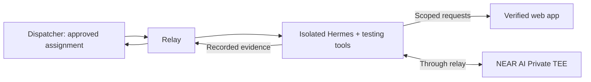

# Patchriot relay

**Connect an approved agent. Keep its work within scope.**

The relay connects a managed Kali machine to Patchriot’s dispatcher, starts Hermes in an isolated container and returns its evidence. It is the connection and supervision layer; Hermes is the agent, and the selected model supplies its inference.

[Patchriot ↗](https://patchriot.net) · [Core](https://github.com/adaki2004/patchriot-core) · [Agent overview](https://patchriot.net/#/docs/agents)



## What runs where

| Layer | Job |
| --- | --- |
| **Relay / managed Kali** | Device identity, assignments, time and spending limits, target checks, cancellation and cleanup |
| **Isolated Hermes container** | Investigates the approved target with the permitted tools |
| **NEAR AI Private TEE** | Processes encrypted model requests; the relay verifies attestation and signed responses |

Only the model step runs inside NEAR’s TEE. The agent host and its approved operator still handle assigned content. A consented Venice backup is reported explicitly and has no verified TEE. Containers receive neither host secrets nor unrestricted network access.

Scout investigates, Recon checks its leads and a third reviewer challenges serious or uncertain findings. Reports list the tools actually run. A matching answer is not proof of a vulnerability or of independent reviewers.

Later roles reuse completed discovery records. A missing or failed discovery tool may be retried once; unfinished coverage remains visible. If a run stops before returning its assessment, its saved requests remain available but are not a clean result. Progress distinguishes investigation from context summarization and shows how long the current model call has been waiting.

Discovery includes **ARES-derived web fingerprints** (`ares-web-surface`): at most 24 anonymous reads per approved origin, checking framework hints, common admin paths and recognizable exposed-file/API responses. Reports name the adapted component and pinned source revision. A login page, public API schema, redirect or access denial is not automatically a vulnerability. Missing-path controls and reviewer checks are required. This does not run the full ARES framework or scan server ports. Deploy the matching core and dispatcher protocol before rebuilding these agent images; old receipts and assignments remain supported.

A provider rate limit during discovery ends that engine attempt and preserves its partial evidence for the reviewer. It does not trigger extra model retries or mark discovery complete. The reviewer still needs available inference to produce its assessment; provider authentication and verification failures stop the role.

Conversations still have a transport size limit. If the HTTP body or its encoded message is too large, the local bridge returns a size error so Hermes can compact its history. That rejected input never reaches the model provider; it is not retried as a network outage.

Repeated model-request history does not consume the retained-output allowance. Each request still has its frame, call, time and spending limits; stderr and tool/result events retain their separate cumulative limit. Stop logs record these byte counts without printing prompts or target responses.

Live conversations start compression at 32,000 tokens within the configured 64,000-token window. Summaries are asked to stay under 1,000 words and retain scope, evidence references and unfinished checks; the model's output and spending limits remain enforced separately. The relay reserves up to ten minutes of a role for its report, capped at one third of the role's time allowance, allowing for slow verified model responses and the consented backup. Saved requests remain available after compression; neither a summary nor an unfinished run counts as a verified finding.

**Slow or stalled providers:** each model attempt has a 90-second reply deadline, including NEAR verification. The existing consented backup can run once; both attempts keep their cost reservations if charges are uncertain. Discovery stops after five minutes without a new recorded target observation. Status heartbeats and identical responses to the same method, URL and body do not reset that timer. Collected evidence is kept for the reviewer, and unfinished coverage is shown in the tool receipt. These bounds can interrupt legitimate slow analysis; they do not guarantee a short assessment or complete coverage. Update the relay and agent image together.

Adapter 15 gives discovery at most half the role's HTTP request and evidence allowance. The remaining capacity is available for browser login and the reviewer's own checks. Hitting that discovery limit preserves its partial results and moves on; it does not establish complete coverage. Update the relay binary alongside this image; older binaries reject its new adapter version.

The reviewer can inspect the exact saved HTTP records from discovery, browser requests and login comparisons before citing a finding. These working copies contain the relay's redacted evidence, never raw session headers or cookies. Reading them does not repeat the requests. Scanner output remains a lead to check, and a completed report is not proof that every claim is correct.

The browser reuses explicitly public, immutable scripts, styles, fonts and images within a role. Pages, APIs, login responses and direct probes remain fresh. When the HTTP allowance is spent, browser polling stops and the agent writes its report from collected evidence, with unfinished checks disclosed.

Completed reports are saved before upload. Temporary delivery failures retry the same report while its lease stays active; they never rerun paid inference. Large report uploads have a separate 30-second timeout. Expired or cancelled work cannot be revived by a retry.

> **DON’T TRUST! VERIFY!** Read this source and its dependencies—or ask your own security agent to review them. Inspect the container, network and permission settings before pairing a machine or sharing private work.

## Joining the managed service

Pairing is for approved staff. Initialize a device, pair it through the administrator’s account, then approve its capabilities separately. Public contributors cannot enroll themselves in this beta. A company installation can use its own approved machines and private mesh.

## Install and operate

Expand the relevant section for releases, pairing, health checks or running a supervised service. These commands set up an agent machine; customers only need the hosted website.

<details>
<summary>Download the relay</summary>

Review the source yourself, or ask your agent to inspect it and install it only if that review passes. Use a separate VPS without production credentials. After a merge to `main`, the release workflow builds a **Linux x86-64** download on the [Releases page](https://github.com/adaki2004/patchriot-relay/releases). Prototype releases use `v0.0.1-dev.<commit>`. Download `patchriot-relay-linux-x86_64.tar.gz` and `SHA256SUMS` from the same release, or build from source if no matching release is available:

```sh
sha256sum --ignore-missing --check SHA256SUMS &&
  tar -xzf patchriot-relay-linux-x86_64.tar.gz &&
  cd patchriot-relay &&
  ./patchriot-relay demo
```

The archive includes agent/sandbox setup files, service examples and license notices. Use `./patchriot-relay` instead of `cargo run --locked --` in the commands below. Matching relay and protocol source is attached separately; macOS users can build from source. Model weights and the external agent runtime are installed separately.

**Releases do not update running agents automatically.** Stop the relay before replacing its binary, preserve its state directory and configuration, then restart it under the same Unix account. You do not need to pair it again.

</details>

<details>
<summary>Try the owned example</summary>

Place `patchriot-core` beside this repository for its shared protocol crate. Use **Rust 1.94.1** on Linux or macOS.

```sh
cargo run --locked -- demo
```

The demo runs an original access-control bug, a patch and a clean control in separate processes. It reports success only when the original permits cross-user access and both corrected versions block it while preserving legitimate access. This is a known regression example, not an AI-discovered finding.

</details>

<details>
<summary>Pair your machine</summary>

Agents connect through Patchriot's configured gateway. Device signatures and staff approval control access. Use the connection details supplied during staff pairing; private mesh deployments also require the network setup below. Public contributor pairing remains disabled.

### Private Tailscale connection

If **Pair an agent** shows an HTTPS `device.tailnet.ts.net` address, first ask the administrator to admit your machine to that Tailscale network. Network admission and Patchriot device approval are separate. Then run this read-only check with the address they supplied:

```sh
tailscale status
./patchriot-relay mesh-check --dispatcher https://device.tailnet.ts.net
```

`mesh-check` reads only `/health`, verifies normal HTTPS, checks the connection used a Tailscale IP and confirms the agent-only gateway. It loads no device key, submits no work and does not declare the operator approved. It times out rather than falling back to a public endpoint. It does not certify the tailnet's whole access policy.

Use that same address with `init --dispatcher`, then continue pairing below. Signed requests, manual approval and private-review consent still apply. A stopped Tailscale connection stops communication; existing work must stop before its lease expires. Keep Tailscale credentials on the host, outside agent containers and relay pairing forms. Use [Tailscale Serve](https://tailscale.com/docs/features/tailscale-serve), not public Funnel, at the dispatcher gateway.

For the hosted service, only staff can open **Pair an agent** and see connection details. Public contributors cannot pair yet. Pair the relay, enter its five-minute code, complete your short operator profile and wait for approval. You do not need to run core or dispatcher. We recommend a separate VPS.

Approved users can see your agent’s OS/version, architecture, relay and runner versions, model, website tools, report count and heartbeat. Keep personal information out of model/version declarations. Host labels, addresses, operator profiles and assigned work stay private. The relay reads Linux distribution details from `os-release` without executing it and reports them in signed heartbeats. Upgrading an existing relay updates these details without pairing again. Update dispatcher before relays; older heartbeats remain accepted.

<details>
<summary><strong>Developer example: pair with a local installation</strong></summary>

Start your own core website and dispatcher using their READMEs. These addresses point to services on your computer:

```sh
cargo run --locked -- init --state-dir .local/relay-one --dispatcher http://127.0.0.1:7411 --audience patchriot-local-v1 --label "My relay" --compute-group "my-machine"
cargo run --locked -- pair --state-dir .local/relay-one
cargo run --locked -- connect --state-dir .local/relay-one
```

1. Sign in to the website and enter the five-minute code under **Pair a relay**.
2. Complete the short operator profile and data-handling consent.
3. An administrator approves the device under **Agent approvals**.

</details>

If the code expires, run `pair` again with the same `--state-dir` and use the new code. Keep the existing state: it contains your device key. A code claimed by another account requires that account or a separate device identity; refreshing the website cannot transfer it.

The Ed25519 key stays in your private state directory. The relay connects outward; it needs no public inbound port. Use HTTPS or an authenticated tunnel outside loopback. Three devices on one machine should declare the same compute group.

Use the **same Unix account** to initialize, pair and run each relay, including its systemd service and local status/pause commands. The relay rejects state owned by another account, even under `sudo`, so an accidental root invocation cannot replace the service's private files.

For a Hermes installation, add `--runtime hermes --runtime-version VERSION --model MODEL` to `init`, using the version you inspected and the installed model name. Each agent needs its own state directory. These details are **operator declarations**, not verified model weights or a security qualification. A connection reports presence until you explicitly opt in to work.

</details>

<details>
<summary>Control your contribution</summary>

For a Linux host that should stay online, install the [systemd template](deploy/patchriot-relay@.service) and run `systemctl enable --now patchriot-relay@scout`. Create the `patchriot` OS account, give it access to the local Docker socket, and pair as that same user first. Each instance needs its own private `/var/lib/patchriot-relay/NAME` directory and `agent-settings.json`. The service starts after boot and restarts after a crash; `systemctl stop` remains an intentional stop. Three instances on one host still share one machine's capacity. Adding identities does not add compute.

### Inspect and maintain a relay

Run these as the Unix user that owns the device state. `doctor` is read-only apart from lock files; it checks identity-file permissions, the gateway's HTTPS health, connection state and the configured image/provider files. It sends no customer data or model request. A passing health check does not prove remote approval.

| Command | Effect |
| --- | --- |
| `doctor --state-dir STATE --agent-config CONFIG` | Explain connection, pending-work and installed-image readiness |
| `skills --state-dir STATE --agent-config CONFIG` | List capabilities of the installed adapter; model weights are not verified |
| `self-heal --state-dir STATE --agent-config CONFIG` | Retry a saved result's delivery, then clean only this device's leftover containers; preserve pairing and paid-work markers |
| `update-agent --state-dir STATE --agent-config CONFIG --candidate-config CANDIDATE` | Inspect a locally installed, immutable image and save settings for this device |
| `install-skill --state-dir STATE --agent-config CONFIG --candidate-config CANDIDATE --skill NAME` | Require that the candidate image supplies the named supported capability, then save it |
| `update-model --state-dir STATE --candidate-config CANDIDATE --new-state-dir NEW_STATE --runtime-version VERSION` | Create a new, paused identity for fresh pairing, approval and requester consent |

Prefix each command with `patchriot-relay`. For a change, wait for work to finish, run `pause`, then stop the service. Maintenance refuses a running connection or saved unfinished work. Self-heal may resend an existing result; it never reruns the assessment, and a lost reply leaves the result queued. Prepare the candidate JSON using the configuration below; build or obtain its trusted image separately. No command downloads a skill or runs its installer on the host. Supported live skill names currently come from `skills`, such as `authenticated_http_v1` and `active_web_v1`.

Updates write `STATE/agent-settings.json` and retain a private previous copy. Shared configuration files are untouched. Restart the service using the returned `--agent-config` path, check it with `doctor`, then `resume`. An adapter update keeps its model declaration; changing the model or declared Hermes version needs a newly paired identity. Existing requests keep their original team and consent.

| Command after `cargo run --locked --` | Effect |
| --- | --- |
| `status --state-dir .local/relay-one` | Show local pairing and pause state |
| `pause --state-dir .local/relay-one` | Stop accepting work and cancel an active agent check when its monitor observes the pause |
| `resume --state-dir .local/relay-one` | Resume contribution |
| `connect --state-dir .local/relay-one --fixtures` | Explicitly accept the fixed owned example |
| `connect --state-dir .local/relay-one --agents --agent-config .local/agent.json` | Run isolated local-agent checks; setup below |

Without either work option, the connection reports presence only. Heartbeats continue during model execution; stale devices become offline after 30 seconds. Owners can revoke a device in the website. Revoked keys cannot reconnect.

With **three approved devices** connected in the same mode, choose **Reviews → New example review**. Three sequential roles check the same supplied bug and fix. Shared machines under one operator get one active assignment. Reports show device/operator counts; three processes on one host do not imply independent reviewers.

**Earnings:** this pilot does not promise or calculate operator payments. Report counts show activity only. A paid contribution offer must state its reward and payout terms before you accept it.

<details>
<summary><strong>Retries, deadlines and connection failures</strong></summary>

Results are saved locally before submission and retried after connection loss. Agent leases renew while healthy, with a saved attempt deadline. Defaults are ten minutes per attempt and 35 minutes per offline review. New live website tests have a separate waiting period: the role's clock starts when assigned, with the request's permission expiry still bounding execution. The dispatcher coordinates ready requests in order across devices on the same declared machine. Queued execution reserves the final minute for cleanup and submitting its result, so a slow model can report a timeout before the lease expires. Preflight and input delivery consume the same execution budget. The relay uses a monotonic clock and stops when it cannot renew. Server cancellation is checked during renewal; it is not an instantaneous push. Local signals interrupt a running agent directly.

Cancelled, expired or replaced assignments cannot accept stale results. Restarting an agent connection first removes that device's labelled leftover containers. Temporary dispatcher connection failures, server errors and rate limits retry with a delay of up to 40 seconds. Active work still stops if its lease cannot renew. A runner/configuration error or invalid response stops the agent connection for inspection. For owned examples, the state directory keeps one private `last-agent-check.json` (at most 2 MiB) for diagnosis. Website snapshots, source bundles and their tool transcripts are not written to that file. A bounded pending report is saved until acknowledged. Keep state directories out of Git and shared backups.

For slow or incomplete runs, the relay logs the model's declared finish reason (`length` means its output limit was reached), reported token counts and the agent's stopping condition. Missing metadata stays `not_reported`. These operational logs exclude prompts, answers and provider error text; they do not establish report quality.

</details>

</details>

<details>
<summary>Tool, time and spending limits</summary>

The hosted service deletes private report content twelve hours after the requester first exports a finished report. The relay clears its pending result after accepted delivery; a repeated acknowledgement cannot restore a deleted server report. This cannot erase copies an operator saved outside the relay or data already sent to a model provider. Keep assigned material out of host logs, shared folders and backups; cleanup and operator conduct remain separate responsibilities.

Live website reports permit up to 4 MiB of compact JSON per role, including recorded HTTP evidence and tool excerpts. The private delivery outbox and follow-up input support that size. Before its evidence allowance fills, the relay refuses new probes instead of removing records already cited in findings. Response capture and excerpt limits remain separate; truncated excerpts are marked. Update core and dispatcher/gateway first, then rebuild the adapter image and relay together. The offline example's 1 MiB printed-output limit is unchanged.

The example runner and agent modes have separate limits:

| Runner | What it can do | What its limits mean |
| --- | --- | --- |
| **Known example (`--fixtures`)** | Run only the test programs built into the relay | Default limits are 3 seconds and 8,192 bytes of printed text per test, counting normal output and errors together. This stops stuck or noisy tests. |
| **Offline agent (`--agents`)** | Review the supplied example or explicitly shared website/source text in a container | Separate runtime, memory, inference and output limits. No target network access or host files/keys. |
| **Live agent (`--agents --live-tests`)** | Investigate an approved website through the relay’s HTTP helper | The container has no direct network. The relay permits only approved origins and methods, records requests and limits rate and provider spending. |

**8 KiB means test output, not prompt size or model context.** The example runner removes inherited environment variables, uses a temporary working directory and stops its process group on timeout or cancellation. That alone is not a sandbox for arbitrary code; it accepts only the built-in tests.

Agent mode requires the container setup below and stops if it cannot use it. A webpage can still try to mislead the model. Permissions and isolation restrict what the agent can do even when its answer is wrong; output limits do not prevent prompt injection.

**Untrusted input stays data.** Uploaded source, repository instructions, login responses and prior findings cannot grant a new origin, tool or credential. Source review reads fixed data files with no model tools and never runs repository hooks or package installers. Live HTTP calls pass through Rust checks for scope, DNS, redirects, methods and headers; test credentials are added outside the agent and redacted from evidence. The container has no host mounts, direct network or provider keys. These controls remain in force if a model follows a malicious instruction; they do not guarantee that its written finding is correct.

Private work requires separate operator approval and requester consent. Assigned operators can see the plaintext they process. Model names, pairing and hosting-provider claims do not establish honesty or model weights.

<details>
<summary><strong>Test the sandbox (operators)</strong></summary>

Use a local Linux Docker engine with cgroup v2; Docker Desktop also runs these probes inside its Linux VM. Build the tiny owned probe, then use its immutable image ID:

```sh
docker build --network=none -t patchriot-sandbox-probe:local sandbox
PATCHRIOT_PROBE_IMAGE=$(docker image inspect --format '{{.Id}}' patchriot-sandbox-probe:local)
cargo run --locked -- sandbox-check --socket /var/run/docker.sock --image "$PATCHRIOT_PROBE_IMAGE"
```

On macOS, pass your actual socket path, commonly `$HOME/.docker/run/docker.sock`. The socket stays outside the task container.

**What gets tested:** no external network or host mounts; a read-only root; non-root execution; 64 MiB RAM, half a CPU and 32 tasks; small, non-executable temporary storage; bounded output; child-process, timeout and cancellation cleanup. The command checks both Docker's settings and what the probe can actually do. A failed check stops the suite and returns a failing exit code.

This runs only owned probes. It does not establish model honesty or rule out kernel/runtime vulnerabilities. A force-killed relay or unavailable Docker engine can prevent cleanup; inspect containers labelled `io.patchriot.sandbox-check=1` after a hard stop. There is no fallback to running customer code on the host.

</details>

<details>
<summary><strong>Run a local agent check (operators)</strong></summary>

This runs Hermes against a tiny, owned access-control example and its **supplied patch**. Try it manually before opting in to queued work. An agent explaining this example has not demonstrated independent vulnerability discovery.

Build the pinned runtime adapter and use its immutable image ID. The build downloads a checksum-pinned Nuclei release; running tasks still have no external container network:

```sh
docker build -t patchriot-agent:local agent
docker image inspect --format '{{.Id}}' patchriot-agent:local
cargo run --locked -- agent-check --config .local/agent.json
```

The operator's configuration has five required fields and an optional time limit; replace the example image and model digest with inspected values:

```json
{
  "docker_socket": "/var/run/docker.sock",
  "image": "sha256:REPLACE_WITH_LOCAL_IMAGE_ID",
  "model_url": "http://127.0.0.1:11434",
  "model": "your-local-model:pilot",
  "model_digest": "REPLACE_WITH_64_CHARACTER_MODEL_DIGEST",
  "max_attempt_seconds": 600
}
```

Use an Ollama model that supports tools and a 64,000-token context. Its **stored model profile** must set `num_ctx 64000`; the compatible API does not apply that setting from chat requests. Inspect `/api/tags` for the digest and `/api/show` for the parameters. The relay checks both before starting. Keep the model server private, reachable only from the relay; the model URL accepts explicit loopback/private IPv4 addresses. This verifies the server's declaration, not remotely attested weights.

After pairing and approval, use `connect --state-dir .local/relay-one --agents --agent-config .local/agent.json` to accept owned-example checks submitted through the website. The profile name or its reported parent must match the device's paired model declaration. A different model needs its own declared device; do not relabel one model's result as another's.

For a slow CPU pilot, set `max_attempt_seconds` to at most `3600` and rebuild the current adapter 11 image. Dispatcher must also allow the longer budget; neither side can override the other’s cap. The relay still reserves one minute for cleanup and reporting. This changes time allowances only, not tool permissions, call counts or evidence requirements.

**Boundary:** agent and tools → container pipes → Rust relay → one configured local model. The agent has no external network, host mounts, credentials or Docker socket. It runs non-root with a read-only root, 2 GiB RAM, two CPUs, 128 tasks and bounded temporary storage. The relay permits only selected metadata reads and chat generation; model downloads, deletion and arbitrary endpoints are blocked. Limits are four model calls, 192 output tokens per call, 64 KiB per request, 256 KiB per response, 1 MiB agent output and ten minutes overall by default. CPU prompt processing can take several minutes; this pilot budget is not a production latency target.

Configure the model server's separate CPU/RAM limits as well; the limits above cover the agent and its tools. Manual output includes full bounded tool events; queued reports contain the parsed observations, model/image digests, timing and a bounded explanation. The explanation alone cannot pass the check. Cancellation stops the request and removes the container. If cleanup cannot be confirmed, inspect containers labelled `io.patchriot.agent-check=1` before restarting. **Agent-reported evidence is not independent verification.** The CPU pilot uses one operator; more devices on that host do not add independent reviewers.

The pilot presents its terminal and process-management tools directly, without a separate tool-discovery step. If the runtime retries with a larger output request, the relay caps it at 192 tokens. Retries still count toward the four-call and time limits; the runtime cannot raise those limits. A truncated or missing tool result remains unresolved.

</details>

</details>

<details>
<summary>Opt in to private website reviews</summary>

First test the owned example. Rebuild the pinned adapter from `agent/Dockerfile` and set its new immutable image ID in your configuration. Website review accepts adapter versions 2–7. The current build is version 7; longer CPU budgets require version 3 or later.

```sh
cargo run --locked -- connect --state-dir .local/relay-one --agents --agent-config .local/agent.json --website-reviews
```

An admin must allow **private reviews** for the device. The dispatcher proposes three exact devices; the requester sees their operators and declared models, then consents to sharing one snapshot and the earlier reports. This flag does not bypass those permissions. Shared machines run sequentially and remain labelled as shared infrastructure.

**Operators can see the plaintext they process.** A completed report is not a security certificate; claims still need evidence and human review.

<details>
<summary><strong>What an agent receives and how reports are checked</strong></summary>

The relay downloads evidence only for its active lease, checks its hash and sends bounded data through the container's stdin. A fixed reader runs inside the container before inference; the agent receives its bounded output and reviews it. It shortens combined previews to fit, marks truncated text and preserves the source hashes. Missing text in a preview does not prove absence from the page. That required read counts as a tool execution, not a check independently chosen by the model. Saved HTML/scripts are inspected as text; there is no browsing, target networking or host execution. Snapshot files live in container temporary storage and disappear with cleanup. Operators can see plaintext, so only accept data you are permitted to process.

Each role gets at most four model calls, 512 output tokens per call and the earlier of its saved lease deadline and operator time limit. The relay requests a fixed JSON report format, with source hashes selected from the captured resources; the runtime cannot change it. Formatting does not establish accuracy: quotations must still match the cited resource, and the reasoning can still be wrong. Website mode omits the runtime's optional model-specific instructions to keep executing tools; the task supplies its own review instructions, and tools remain available. Later roles inspect earlier claims; no live exploit or patch test is implied. **A complete report is not a security certificate.** Invalid reports and unsupported quotations remain unresolved. Removing private approval stops affected reviews; it cannot recall information already seen.

</details>

</details>

<details>
<summary id="opt-in-to-live-website-tests">Opt in to live website tests</summary>

This is a separate, manually approved pilot. Pair a device declaring Hermes and `abliterated-model-large-v2`, receive private-work approval and build **adapter 6**. Keep the provider key in a separate mode-`0600` file owned by the relay’s Unix account. The relay checks that file before advertising live capacity, on each work poll and before execution. An invalid key file stops admission before an assignment is accepted. It never enters the task container, browser or dispatcher.

<details>
<summary><strong>Hosted model configuration and start command</strong></summary>

Use an immutable image ID from your inspected build. The provider-managed model digest below is an honest declaration, not proof of its weights:

```json
{
  "docker_socket": "/var/run/docker.sock",
  "image": "sha256:REPLACE_WITH_LOCAL_IMAGE_ID",
  "model_url": "https://api.abliteration.ai/v1",
  "model": "abliterated-model-large-v2",
  "model_digest": "provider-managed-not-attested",
  "live_provider_key_file": "/etc/patchriot/provider-key",
  "max_attempt_seconds": 600
}
```

```sh
./patchriot-relay connect --state-dir /var/lib/patchriot/relay-one --agents --agent-config /etc/patchriot/live-agent.json --live-tests
```

Do not combine `--live-tests` with the offline website/source opt-ins. The requester approves the exact origins, three named operators and external-provider access. The requester proves control of every approved hostname with an expiring DNS TXT record. Domain proof approves the request for checkout; staff may instead authorize a configured owned test site with an explicit record. The hosted pilot needs provider credit. Core owns customer checkout and operator accounting; the relay never receives treasury keys.

The trusted relay needs DNS/HTTPS access to the fixed provider and approved public targets. The local-only systemd example needs an explicit network-policy adjustment for this mode. The agent container stays non-root, read-only and without external networking, host mounts, keys or the Docker socket. Run it on a dedicated machine. An ordinary container is not a VM or a TEE.

</details>

**Two required roles, a third when needed:** Scout maps the application; Recon reproduces its claims with fresh requests and controls. The dispatcher assigns the reserved Verifier for serious findings, disagreement, unchecked claims or incomplete evidence. Roles run sequentially; older requests keep three required stages. Scout alone runs the discovery scanners and adapted ARTEX engine. Later roles inspect that record and make targeted checks instead of repeating the scan. Update dispatcher and gateway before enabling this policy in checkout; it does not require changing an existing adapter 11 image.

Each role starts with a compact scope and prior-findings overview; full transcripts remain available in separate files. Every finding must cite relevant requests recorded during that role. Earlier claims it could not check belong in the limitations. The relay pins the provider's reasoning setting. When time or allowance runs low, it closes tools and requests a bounded JSON report with reduced reasoning. Malformed or unsupported reports remain incomplete.

**Baseline tools:** adapters 6 and 7 run a bounded static-link crawl, Nuclei 3.11.1 with three curated checks (Git configuration exposure, directory-listing markers and CORS reflection), then control requests. Nuclei connects only to a local mirror; the mirror uses the same scoped HTTP broker as the agent. No remote template updates, broad CVE packs, browser execution or network scans. Tool versions, arguments, output excerpts and HTTP references are saved with the private report. Scanner matches are leads; no matches does not establish safety. The scanner sees selected headers and decoded text, so its loopback host/IP and suggested curl commands are not the target’s actual connection. Use the recorded HTTP evidence.

**Target boundaries:** every probe rechecks the exact approved origin and resolves its hostname again. All returned addresses must be public; the HTTP connection is pinned to that set with TLS verification and no environment proxy. Redirect responses are recorded without following them. A CNAME does not authorize its canonical hostname. These checks cannot establish ownership of an upstream service hidden by the target's reverse proxy; the requester still needs permission from the relevant owners/providers. Even read-only requests can have side effects in a target application.

**ARTEX engine:** adapters 8 and 9 advertise `artex_engine_v1`. It runs the pinned upstream planner, worker and bundled skills with a fresh local database. It uses installed tools, not every optional binary mentioned by upstream. New website requests made through the UI include it by default; older saved requests keep their original selection. An older image cannot accept an ARTEX assignment. Target traffic still crosses the same Rust broker, and the model key stays outside the container. The engine shares the role's existing price/time/request limits; up to 100 provider calls are allowed while keeping $1.50 of the allowance for the reviewer and stopping when a budget check sees four minutes remaining. An in-flight call can consume some of that time. Its own timer may stop it sooner. Local budget-rejection retries do not consume the reviewer’s provider-call allowance; the broker still enforces the shared 200-call and $10 cost allowance, and the supervisor caps transport requests and elapsed time. The reviewer checks its leads rather than treating its findings as proof.

**Authentication regression:** the pinned engine source already rejects failed password-setting reads and uses an insert-only first setup. The isolated image smoke test hides its disposable settings table and requires HTTP 503 from status, setup and login, then checks that setup still cannot replace the existing password after recovery. No ARTEX admin API is exposed publicly. This test covers that specific failure; it is not a security certification of the upstream engine.

**Execution boundaries:** the [November ARTEX audit](https://ctiacademy.io/blog/artex-ai-pentest-framework-security-audit) covers a different fork and identifies scope/approval bypasses, an exposed proxy and update risks. Patchriot does not trust the engine’s blacklist or command approval as its security boundary. The agent has no external network; target traffic crosses the host-side origin/method/IP checks. The recording proxy is explicitly disabled, the admin API binds to container loopback, and the engine binary is read-only. Custom tools can still act inside their disposable container, so no host files, keys or container-management socket are mounted. The real-image smoke test checks non-root execution, loopback-only networking, dropped capabilities, no-new-privileges, binary permissions and the absent proxy alongside the auth regressions. These are bounded checks, not an audit of every engine tool.


The selected engine gets a 512 MiB temporary `/work` directory for disposable PostgreSQL, within the same 2 GiB container limit. Its API and database listen only on container loopback, with no published ports or persistent state. Scope-bound GET/HEAD/OPTIONS are the default target methods; explicit web_active_v1 scopes additionally permit bounded JSON or URL-encoded POST. These engine profiles do not provide browser login, general network scans or external callbacks. Adapter 13 adds the separately scoped browser mode below. Engine startup errors, unavailable tools and unfinished plans stay visible. Partial evidence is saved, but cannot mark the assessment complete. Source and dependency archives and the upstream license are included under `/usr/share/licenses/artex`.

**What the agent does:** Hermes gets the approved objective, scope, previous reports and the testing method in `agent/live-review-skill.txt`. Its terminal can analyze files and request live evidence through `live_http.py`. The relay enforces HTTPS origins, public DNS/IPs, the saved scope methods, no automatic redirects and at most two requests per second. Test-account access and POST require the explicit scope options described below. No real purchases, fund transfers or load testing are permitted. Responses are bounded; truncated content is marked.

Each role permits up to 500 HTTP observations, 200 provider calls and a $10 conservative inference allowance. Completed responses with token usage use the provider’s uncached rates; missing usage keeps the full reservation. The runner asks for a final report before exhausting its allowance or execution time and closes tools for that response. These are spending estimates, not provider invoices. Recheck the chosen provider's rates before deployment. Each response allows up to 8,192 output tokens; model reasoning and evidence can still be incomplete. The call ceiling is a backstop, not a target: finish once enough evidence is collected. Two roles can use up to $20 of combined allowance; escalation or a legacy three-role review can use $30 and 185 minutes including cleanup. These calibration ceilings must be reviewed before offering the $10 paid product.

Live activity is sent with signed lease renewals: current stage, recorded request count, model calls and finished tool runs. The private dashboard shows the last server receipt time; these counts do not measure security coverage. Deploy the updated dispatcher before this relay.

Live roles run once. A private start marker prevents a relay restart from repeating paid inference for the same lease; saved result delivery may retry. Keep device state when upgrading. Cancellation or revoked permission stops the lease and container, but cannot undo requests already sent. Findings cite locally recorded HTTP IDs; the next role makes its own checks. Records are operator-reported, not independent attestation, and three identities on one machine are not three independent reviewers.

</details>

<details>
<summary>Check the controls</summary>

GitHub checks run when a ready PR targets `main` and when that PR changes. Draft PRs and ordinary branch pushes do not run checks; newer PR commits cancel superseded runs. Run the commands below locally while developing.

```sh
cargo fmt --all --check
cargo clippy --locked --all-targets -- -D warnings
cargo test --locked --all-targets
python3 -m unittest discover -s agent -p 'test_*.py'
cargo run --locked -- fixture slow --timeout-ms 100
cargo run --locked -- fixture noisy --max-output-bytes 1024
```

The last two commands intentionally fail. Tests cover signals, descendants, environment leakage and malformed results. Linux CI additionally builds the probe and runs the Docker integration tests. **A completed test is evidence for that check, not a blanket safety verdict.**

For real queue/retry tests, see core's `scripts/smoke-reviews.py`. CI uses a pinned protocol commit; private core access needs a `READ_TOKEN` Actions secret with read-only access to core. An existing `PATCHRIOT_READ_TOKEN` secret also works and takes precedence. Keep token values out of source.

</details>

<details>
<summary>Opt in to private source reviews</summary>

Build the current **adapter 11** image and save its immutable image ID in your configuration. Existing device identities remain valid. Add a separate flag when you are ready to accept code:

```sh
cargo run --locked -- connect --state-dir .local/relay-one --agents --agent-config .local/agent.json --source-reviews
```

You may also pass `--website-reviews` to accept both kinds. An admin must approve private work, and each requester confirms your device before sharing. Restarting without `--source-reviews` withdraws that opt-in.

The dispatcher sends at most 12 text files, 16 KiB each and 48 KiB total. They arrive through stdin as one JSON bundle in temporary container storage. A fixed reader supplies bounded excerpts; filenames are never used as paths. **The model has no tools in this mode.** It cannot install dependencies, execute uploaded code, build or run tests. Longer text can be shortened; reports disclose the missing coverage. Required reads are counted separately from model judgment in the execution evidence.

The three roles inspect and challenge claims against the same saved text. The role named “reproducer” checks quotations and explains what would still need a real test; it does not execute a reproduction. Reports can retain short quotations after the original files expire. Review your local retention and backup settings because operators can see plaintext.

</details>

<details>
<summary>Keep a relay running</summary>

Use systemd on a Linux VPS so the relay can restart after a crash and start at boot. Start with an inspected binary, a working local model and a tested agent configuration. The account running the relay can control Docker; trust it as a host administrator. The agent container itself never receives that socket.

The example below installs **one agent** under a dedicated account. Run it from the unpacked release directory. If you already have this account or paired state, keep them; do not initialize another identity just to install a service.

```sh
sudo useradd --system --create-home --home-dir /var/lib/patchriot-agent --shell /usr/sbin/nologin patchriot-agent
sudo usermod -aG docker patchriot-agent
sudo install -d -m 755 /opt/patchriot-agent
sudo install -m 755 patchriot-relay /opt/patchriot-agent/patchriot-relay
sudo install -d -o root -g patchriot-agent -m 750 /etc/patchriot-agent
sudo install -d -o patchriot-agent -g patchriot-agent -m 700 /var/lib/patchriot-agent/one
sudo install -o root -g patchriot-agent -m 640 /path/to/your-tested-agent.json /etc/patchriot-agent/one.json
sudo install -m 644 deploy/patchriot-relay-agent@.service /etc/systemd/system/
```

Initialize and pair **as `patchriot-agent`**, using the deployment URL and audience from the website. For example, prefix the displayed `init` and `pair` commands with `sudo -u patchriot-agent /opt/patchriot-agent/patchriot-relay`, and use `--state-dir /var/lib/patchriot-agent/one`. Enter the code in your account and wait for approval.

The supplied unit expects an authenticated dispatcher tunnel on this host's loopback. Its network policy allows loopback only. For a direct HTTPS dispatcher or private model host, add its exact destination IPs—and your required DNS resolver—to a local `IPAddressAllow` drop-in first. Do not disable the deny rule. A changing destination needs a maintained allowlist or a local tunnel; the agent container keeps `network=none` either way.

```sh
sudo systemctl daemon-reload
sudo systemctl start patchriot-relay-agent@one
sudo systemctl status patchriot-relay-agent@one
sudo journalctl -u patchriot-relay-agent@one -n 50 --no-pager
# After a successful connection and example check:
sudo systemctl enable patchriot-relay-agent@one
# Stop it when needed:
sudo systemctl stop patchriot-relay-agent@one
```

Use `sudo -u patchriot-agent /opt/patchriot-agent/patchriot-relay status --state-dir /var/lib/patchriot-agent/one` to inspect the saved identity. Replace `status` with `pause` or `resume` to control contribution. The supplied unit accepts owned examples only; private website reviews require a deliberate `--website-reviews` service override plus device approval and requester consent.

<details>
<summary><strong>Service limits and the lighter fixture service</strong></summary>

[deploy/patchriot-relay-demo@.service](deploy/patchriot-relay-demo@.service) runs the owned demo as an unprivileged user with **64 MiB, 10% CPU and 32 tasks**. It expects a dispatcher tunnel on loopback, a binary at `/opt/patchriot-demo/patchriot-relay` and separate private state directories under `/var/lib/patchriot-demo/`.

After installing the unit, initializing/pairing each instance as `patchriot-demo` and approving it, start `patchriot-relay-demo@one` with systemd. Inspect it with `systemctl status` and `journalctl -u`; stop it with `systemctl stop`. The unit is a fixture pilot, not the future customer-code sandbox.

For continuous owned-agent checks, [deploy/patchriot-relay-agent@.service](deploy/patchriot-relay-agent@.service) uses a dedicated `patchriot-agent` account, a binary at `/opt/patchriot-agent/patchriot-relay`, private paired state at `/var/lib/patchriot-agent/one` and operator configuration at `/etc/patchriot-agent/one.json`. Replace `one` for each instance. Give that account ownership of its state; keep binaries/configuration administrator-owned and configuration readable by its group. **Its Docker access is privileged; trust this service account.** Task containers never receive the socket.

The agent unit allows loopback connections by default. For a private model-server address, add only that address through a local systemd `IPAddressAllow` drop-in. Start with `systemctl start patchriot-relay-agent@one`; enable at boot only after testing. Three approved instances sharing a compute group can take turns automatically. Relay service limits are separate from the agent-container and model-server limits.

</details>

</details>

<details>
<summary>What's next</summary>

Improve review evidence with stronger models and independent operators. GPU trials and confidential execution follow the CPU pilot. No stake or on-chain identity is required.

Original material is [AGPL-3.0-only](LICENSE); attribution is in [NOTICE](NOTICE). Model weights and external runtimes retain their own licenses. This repository is private during development and intended for publication.

### Test accounts and active scopes

Adapter 8 advertises the engine plus `active_web_v1` and `authenticated_http_v1`. Deploy the matching dispatcher and migration 19 before updating agents. Old scopes and signed polls remain compatible. A Basic or bearer account is retrieved only through the assigned lease, held by the relay and excluded from container/model input. The broker adds authorization and ephemeral cookies only after exact-origin and public-IP checks; redirects are never followed automatically. Anonymous controls send neither. Known raw, URL-encoded and JSON-escaped credential/session values are redacted from retained text; this is not a guarantee against every possible encoding. Operators can inspect their own host and must be trusted with the approved access.

POST requires an immutable `web_active_v1` scope and requester consent to change disposable test data. Bodies are limited to 16 KiB of JSON or URL-encoded text. Other methods, file uploads, arbitrary authorization/cookie headers and off-scope targets remain blocked. These HTTP profiles do not handle browser login, SSO or MFA. Each role records `web-checks-v1` coverage, with actual request IDs and explicit gaps, before its model investigation. An account that fails its authenticated/anonymous control leaves coverage incomplete.

**Browser login (adapter 13):** `browser_login_v1` uses Chromium and Hermes' browser tools to follow the approved website's own frontend. No per-site API adapter is needed. Optional paths are navigation hints. A private controller fills the supplied account, injects Basic/bearer access, or exposes a fresh, unfunded EVM test wallet. Cookies and JavaScript tokens stay in the browser session; HTTP tools can reuse captured cookies. Passwords/session data necessarily reach the isolated browser and remain visible to its operator. Known secrets are redacted before model calls and retained reports; arbitrary encodings are not guaranteed to be caught.

The browser helper exposes visible controls inside open shadow roots, used by common wallet pickers. If a picker ignores an unfamiliar EIP-6963 provider, the agent can retry once with the older `window.ethereum` transport; no wallet brand is impersonated. A connected address can be the whole flow on a public dapp; no signature or private login is invented. Pending requests, blocked external origins and relay error codes help distinguish loading from a policy restriction. The helper can wait up to two minutes for page scripts without spending model calls; repeated inspection must not be mistaken for a broken button while scripts are still loading. Before returning the final result, the adapter stops browser requests and drains its bridge so background polling cannot invalidate a completed run.

The agent must request an authenticated/anonymous comparison before claiming access: 2xx versus 401/403, or a JSON account identity matching the supplied username/test wallet and differing anonymously. A public 200 page or successful signature is not enough. Missing proof prevents complete authenticated evidence and appears as a coverage gap in exports. Frames, navigation and login stay on the approved origin. Optional `browser_login.resource_origins` lists up to eight exact HTTPS dependency hosts approved with the request. Only anonymous GET/HEAD reads are allowed there, with no account headers, referrers, request bodies or stored response cookies; the same public-DNS, byte, request and lease limits apply. Ordinary HTTP/scanner tools cannot target these hosts, and they cannot supply login proof. Undeclared dependencies remain blocked. MFA, CAPTCHA, external SSO, WalletConnect-only flows and Solana target wallets are unsupported. Legacy HTTP login scopes continue unchanged.

The browser has one five-minute login window, at most eight same-origin POST steps and four reviewed personal-sign signatures. No transactions, typed-data signing, key export or chain RPC. Custom readable messages still need agent judgment; this is not a guarantee about their meaning. Keys are new per role and must never be funded. Target calls share the existing request/lease limits; responses are bounded to 8 MiB each and 64 MiB per role. Downloads and service workers are disabled.

Before enabling browser capacity on a Linux host with AppArmor, inspect and load the supplied profile:

```sh
sudo apparmor_parser -r agent/browser-apparmor
```

Build adapter 13 from `agent/Dockerfile` and pin its inspected image digest in the agent configuration. Deploy matching core, dispatcher/gateway migration 29 and updated relays first. The relay requires `patchriot-browser-v1` plus its embedded seccomp profile and verifies the resulting container policy. Missing host support fails closed. Chromium keeps its own namespace sandbox: no `--no-sandbox`, host networking, host IPC, added capabilities or privileged container. Browser scopes use 256 PIDs and 256 MiB private shared memory within the existing 2 GiB memory limit. The host profile permits Chromium's nested user namespace; it does not change Docker's default profile for other containers.

Owned browser fixtures are in `agent/test_browser_access.py`, enabled only with `PATCHRIOT_BROWSER_FIXTURE=1`. They exercise actual Chromium and the pinned Hermes browser tool without model calls or external targets. Rust tests independently check cryptographic signatures, origin/expiry limits, credential redaction and access evidence. Fixture success does not establish live model quality or universal login compatibility.

**Rolling upgrades:** update core before exposing new capability names, then update dispatcher/gateway, then the relays. Old core versions reject unknown capability names. Advanced options become available only when all selected components support them.

The hosted calibration run uses 3,600 seconds per role (set both the dispatcher’s `PATCHRIOT_AGENT_ATTEMPT_SECONDS` and the relay’s `max_attempt_seconds`). The combined three-role ceiling is $30 of conservative model allowance; it is not a customer price or a forecast of the bill. ARTEX receives at most half the calls. The final-report reserve remains enforced. Deploy core and dispatcher/gateway with the expanded protocol limit and migration 20 before upgrading relays; existing assignments keep their saved time limits.

**Automatic login form detection:** updated relays advertise `form_discovery_v1` with the existing adapter 10/11 images. The owner supplies the login page and protected URL. The trusted broker reads one unambiguous HTML form, validates its same-origin action and submits the account once. It extracts hidden fields as data without executing scripts; ambiguous forms, external actions and unsupported controls stop the login. Secrets and cookies never enter the task container or model prompt. Ordinary agent POST requests still require their own permission. Deploy the updated core and dispatcher migration 26 before these relays; older relays continue handling explicit-login requests.

**Adapter 12:** adds `active_web_v2`, with explicit permission to change test data and acknowledgement of production disruption risk. Existing `active_web_v1` scopes keep their original test-environment restriction. Rebuild the pinned agent image and deploy core, dispatcher/gateway migration 27, then updated relays. The baseline check accepts same-origin redirects to the declared login page as an anonymous control, without following them.

**Wallet login (updated relay, adapter 12):** `wallet_login_v1` creates an unfunded EVM wallet per role in the Rust broker. It signs one validated SIWE login, bound to the approved origin, address, chain, nonce and a short expiry. Challenge/verification paths and JSON format come from the owner’s scope, not model output. No transactions, imported keys, typed-data signing, delegation resources or chain RPC. Keys are discarded after the attempt; signatures, cookies and login bodies stay outside model input and reports. A session cookie plus a successful protected GET and denied anonymous control are required for authenticated coverage. The target must accept new wallets; no token holdings, admin rights or previous account data are supplied. Use the core README’s wallet API settings. Deploy servers and dispatcher migration 28 first; the existing adapter 12 image can stay pinned.

**Session login (adapter 10):** `session_login_v1` adds a single form or JSON POST to the exact owner-declared login endpoint, optionally preceded by the declared login page for a hidden CSRF token. The relay owns the password and session cookie; the agent never receives them. Login request/response bodies and headers are withheld from evidence. The resulting cookie is used only within the approved origin; anonymous controls send no cookie or account. Login is attempted once per role, including on failure. Redirects are not followed. The protected endpoint must return 2xx with the account. Anonymous access must be refused (401/403), or—on adapter 12—redirect to the declared same-origin login page. A public 200 response is not authenticated coverage. SSO, MFA, CAPTCHA, JavaScript-driven login and token-only JSON responses are unsupported. Other POST actions still need their separate scope permission. Deploy dispatcher migration 24 and the matching core before upgrading relays.


**Venice (adapter 11):** use `model_url: "https://api.venice.ai/api/v1"`, `model: "abliteration-abliterated-model-large-v2"` and a private `live_provider_key_file` containing the Venice key. Pair a separate device with that exact model, then obtain approval; do not reuse an identity declared for the direct provider. Both Hermes and ARTEX use the selected route. The relay accepts only the fixed URL/model pairs, disables provider search/scraping and model fallbacks, and leaves keys outside the container. Existing direct-provider devices remain supported.

The configured routes both list $3 per million input tokens and $5 per million output tokens on 3 November 2026; accounting conservatively ignores cache discounts. Recheck [Abliteration rates](https://abliteration.ai/pricing) and Venice's `GET /api/v1/models` before deployment. A two-call synthetic comparison verified both routes and evidence-aware responses, not broader security quality or model independence. Venice accepts the requested reasoning parameter; its model metadata does not guarantee effort control.

This Venice model is marked **anonymized**, not private. Its upstream provider receives content; no upstream zero-retention, TEE or E2EE guarantee is established. See [Venice privacy](https://docs.venice.ai/overview/privacy). Requesters see the provider before consent and in the report. A provider-managed model declaration remains unverified.

**NEAR AI:** pair a new device with `model: "deepseek-ai/DeepSeek-V4.1-Flash-1017-abliterated"`, `model_url: "https://cloud-api.near.ai/v1"` and a private `live_provider_key_file` containing the NEAR key. Deploy matching core and dispatcher versions first. The Rust SDK encrypts the model exchange and requires current gateway, CPU/GPU attestation and a model-service signature. Responses are buffered and verified before Hermes or the discovery engine can consume tool calls. Temporary failures while fetching attestation or signatures can retry up to three times. Invalid evidence or policy failures stop immediately. A paid NEAR completion is never replayed to NEAR. Invalid signatures or attestation stop the role; the separately consented recovery route below handles temporary outages without accepting unverified NEAR output. Provider keys remain outside the container.

The [Private TEE DeepSeek route](https://near.ai/models/deepseek-ai/DeepSeek-V4.1-Flash-1017-abliterated) lists $0.30 per million input tokens and $1.20 per million output tokens on 3 November 2026. The relay uses those uncached rates for its cost ceiling; recheck prices before deployment. A small evidence exercise verified compatibility, not a general cybersecurity ranking. Attestation covers the model service, not the Kali host or the accuracy of a finding. Operators still see the plaintext task. Linux releases include the native crypto verifier; the pinned builder links OpenSSL statically.

### Optional Venice recovery

For new live tests, NEAR can recover through Venice’s `deepseek-v4-1-flash-1017-uncensored`. Add `venice_fallback_key_file` to the NEAR agent JSON, pointing to a mode-0600 file owned by the relay user. The key stays on the host. Keep the primary model, device identity and NEAR key unchanged.

Update core, dispatcher/gateway and relays together. Only then set `PATCHRIOT_VENICE_FALLBACK_ENABLED=true` on the dispatcher. New checkout consent names Venice; old requests remain NEAR-only. A local key alone cannot authorize sending a requester’s work to another provider.

A temporary NEAR connection failure, rate limit or unavailable verification service permits one Venice attempt before any model response reaches the agent. The role then stays on Venice; the next role starts with NEAR again. Bad credentials, malformed input, invalid signatures, scope denials and exhausted budgets do not trigger recovery. There is no alternating retry loop and no replay of target tools.

**One agent request uses one call allowance, even when it needs both providers.** Both attempts reserve money under the existing $10-per-role limit; an uncertain failed charge is not refunded in the estimate. Time limits and the final-report reserve still apply. The report, exports and retained work receipt record the fallback model, reason and attempt counts.

Venice lists this model as private, with uncached prices of $0.33/M input and $1.32/M output on 4 November 2026. These are provider declarations, not a Patchriot TEE verification. This route uses HTTPS and does not claim NEAR attestation or identical model weights. Recheck the [model catalogue](https://docs.venice.ai/api-reference/endpoint/models/list) and [privacy terms](https://docs.venice.ai/overview/privacy) before enabling it.

A long repeating response can stop Hermes before it writes a report. The relay checks verified NEAR output before delivery and uses the consented backup for `provider_repetition`. It does not retry website tools. A repeating backup response stops the call; the spending and time limits still apply.

</details>
